# 03 — Camera and durable session lifecycle

```mermaid
stateDiagram-v2
    [*] --> stopped
    stopped --> starting: create durable session; start worker
    starting --> running: camera opened
    starting --> errored: start or camera failure
    running --> stopping: stop requested
    running --> errored: camera or repeated inference failure
    stopping --> stopped: worker and final cleanup finish
    stopping --> stopping: timeout; worker still alive
    errored --> starting: new start after cleanup
```

`src/api/app.py:start_inspection` serializes start and creates the durable session before `service.start()`. `CameraInspectionService` guards its lifecycle, resets tracker/evidence state, reports STOPPING while a worker or cleanup remains alive, and rejects restart until finalization. Worker cleanup releases the capture and closes the session after exit. Shutdown calls stop and leaves the session open if the worker has not finished. `src/api/database.py` binds updates to the durable session.

Simulated immediate first event, duplicate start, failed start/session creation, stop timeout, rapid restart, failed worker, blocked cleanup and settings rollback are covered by the focused suite. Command: `python -B -m pytest -q -p no:cacheprovider tests/test_session_lifecycle_qa.py tests/test_stop_timeout_qa.py tests/test_model_switch_safety.py tests/test_camera_settings_atomic_qa.py --tb=short`: **47 passed**, one dependency warning (`03_lifecycle.log`). No additional code change was justified by these simulations. Actual device acquisition, driver stalls and handle release require real-camera testing; see the baseline risks.
